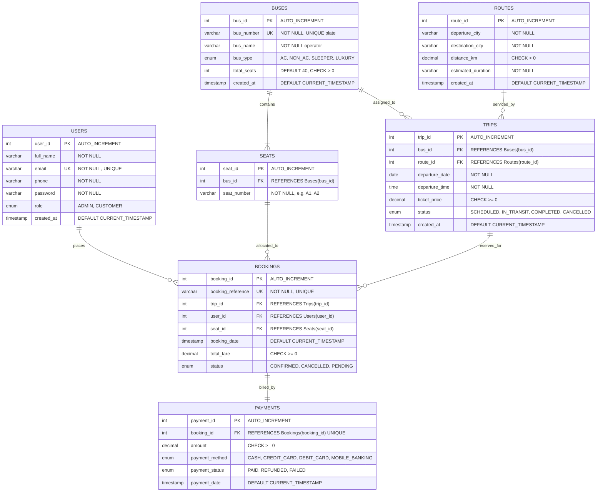

# Entity-Relationship (ER) Diagram & Relational Schema
## Bus Ticket Booking Management System (DBMS Project)

### 1. Architectural Overview & Normalization
The database `bus_ticketing` is designed and normalized up to **Third Normal Form (3NF)** to eliminate redundancy, avoid update anomalies, and enforce strict relational integrity.

- **1NF Compliance:** All attributes contain atomic values. Repeated groups are eliminated.
- **2NF Compliance:** All non-key attributes are fully functionally dependent on the entire primary key.
- **3NF Compliance:** There are no transitive dependencies; non-key attributes depend only on candidate keys.

---

### 2. Mermaid Entity-Relationship Diagram

---

### 3. Detailed Relational Tables & Constraints

| Table Name | Primary Key | Foreign Keys | Key Constraints & Integrity Rules |
| :--- | :--- | :--- | :--- |
| **Users** | `user_id` | *None* | `UNIQUE(email)`, `CHECK(role IN ('ADMIN', 'CUSTOMER'))` |
| **Buses** | `bus_id` | *None* | `UNIQUE(bus_number)`, `CHECK(total_seats > 0)` |
| **Routes** | `route_id` | *None* | `CHECK(distance_km > 0)`, Composite unique logic for city pairs |
| **Seats** | `seat_id` | `bus_id` $\rightarrow$ `Buses(bus_id)` | `UNIQUE(bus_id, seat_number)`, `ON DELETE CASCADE` |
| **Trips** | `trip_id` | `bus_id` $\rightarrow$ `Buses(bus_id)` `route_id` $\rightarrow$ `Routes(route_id)` | `ON DELETE CASCADE`, indexed by `departure_date` |
| **Bookings** | `booking_id` | `trip_id` $\rightarrow$ `Trips(trip_id)` `user_id` $\rightarrow$ `Users(user_id)` `seat_id` $\rightarrow$ `Seats(seat_id)` | `UNIQUE(booking_reference)` **Double-Booking Prevention:** Application checks `WHERE trip_id = ? AND seat_id = ? AND status = 'CONFIRMED' FOR UPDATE` in a JDBC transaction. |
| **Payments** | `payment_id` | `booking_id` $\rightarrow$ `Bookings(booking_id)` | `UNIQUE(booking_id)` (1-to-1 Relationship), `ON DELETE CASCADE` |

---

### 4. Relational Cardinalities & Multiplicities

1. **Users to Bookings (1 : M):**
   - One registered customer can make zero or many reservations over time.
   - Each booking record belongs strictly to exactly one customer.

2. **Buses to Seats (1 : M):**
   - Each bus fleet contains exactly 40 seats (`A1` through `J4`).
   - Each physical seat belongs strictly to one bus.

3. **Buses to Trips (1 : M):**
   - One physical bus can be scheduled across multiple distinct trips over different dates and times.
   - Each trip is operated by exactly one designated bus.

4. **Routes to Trips (1 : M):**
   - One geographic route (e.g., Dhaka to Chittagong) can have multiple daily departures.
   - Each trip corresponds to exactly one origin-destination route.

5. **Trips to Bookings (1 : M):**
   - A single trip departure can have up to 40 passenger reservations.
   - Each booking is bound to a single scheduled trip.

6. **Bookings to Payments (1 : 1):**
   - Each confirmed booking maps to exactly one payment receipt.
   - The foreign key `Payments.booking_id` has a `UNIQUE` constraint enforcing strict one-to-one correspondence.

