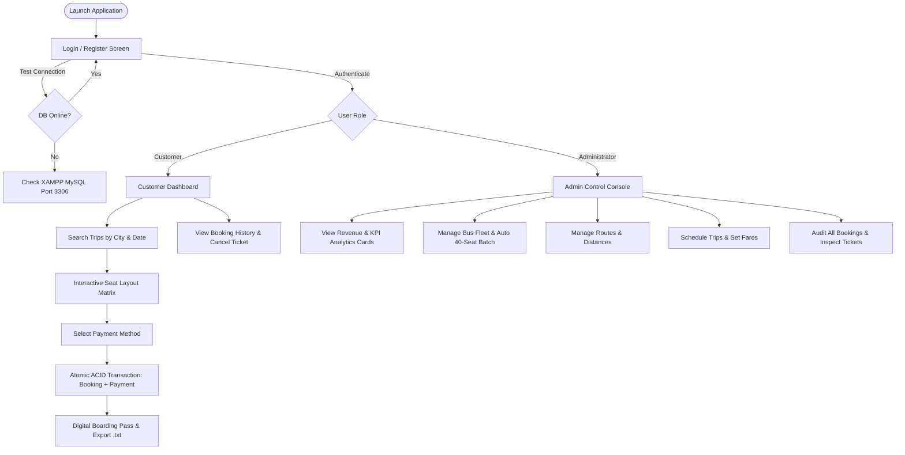

# 🚌 Bus Ticket Booking Management System

<div align="center">

[](https://github.com/Tanvir-PG/Bus-Ticketing-System)
[](https://www.oracle.com/java/)
[](https://docs.oracle.com/javase/tutorial/uiswing/)
[](https://www.mysql.com/)
[](https://www.apachefriends.org/)
[](#-core-dbms-concepts--system-architecture)
[](#3-acid-transactions--concurrency-control)

<p align="center">
  <b>A comprehensive, production-grade desktop application for intercity bus reservation, seat layout visualization, and fleet administration.</b><br>
  Engineered in Java Swing with JDBC and MySQL/MariaDB following strict 3-tier architectural standards, 3NF relational schema normalization, and ACID transactional concurrency controls.
</p>

[Quick Start](#-quick-start--installation) •
[Features](#-core-features) •
[Architecture](#-core-dbms-concepts--system-architecture) •
[Credentials](#-demo-credentials) •
[Testing Guide](#-testing--verification) •
[Directory Structure](#-project-directory-structure) •
[FAQ](#-troubleshooting--faq)

</div>

---

## 📌 Project Overview

The **Bus Ticket Booking Management System** is an end-to-end desktop software solution developed as a University Database Management Systems (DBMS) project. It bridges the gap between theoretical relational database concepts and real-world enterprise software design.

The system addresses the operational challenges of bus transit ticketing by providing:
1. **For Passengers:** A self-service portal to search scheduled trips, select seats through an interactive visual coach layout, process simulated payments, and print/download digital boarding passes.
2. **For Fleet Administrators:** A centralized management dashboard to monitor real-time business KPIs (revenue, booking volumes, fleet metrics), manage buses and routes, schedule trips, and audit reservations.

---

## 🚀 Core Features

### 👤 Customer Experience
* **Live Trip Search & Filtering:** Filter upcoming trips by departure city, destination city, and travel date with instant seat availability counts.
* **Interactive 2x2 Visual Seat Matrix:**
  * Real-time coach seating layout with a central aisle.
  * **Green:** Available for booking.
  * **Red:** Already reserved (disabled from selection).
  * **Blue:** Selected by user.
* **Flexible Checkout:** Support for multiple simulated payment channels (Cash, Credit Card, Debit Card, and Mobile Banking).
* **Digital Boarding Pass Generator:**
  * View formatted monospace ASCII boarding passes directly within the app.
  * One-click **Download / Export Ticket (.txt)** to the local machine via `JFileChooser`.
* **Personal Booking Management:** View comprehensive booking history with live trip status and one-click ticket cancellation that instantly frees up seats.

### 🛡️ Administrative Console
* **Real-Time KPI Dashboard:** High-level analytic metric cards tracking:
  * Total Reservations
  * Total Revenue Generated
  * Active Fleet Size
  * Total Route Network
  * Registered Customer Count
* **Bus Fleet Management:** Complete CRUD operations. Adding a bus automatically generates its full 40-seat matrix (`A1` through `J4`) in a batch database transaction.
* **Route Logistics:** Add, update, and remove intercity routes with origin, destination, distance (km), and estimated travel time.
* **Trip Scheduler:** Plan departure dates, departure times, and ticket pricing linked to active buses and routes.
* **Master Reservation Inspector:** Searchable audit log of all bookings across all trips, complete with passenger details, seat allocations, payment statuses, and digital ticket inspection.
* **Customer Registry:** Roster of registered users with timestamps and contact details.

### ⚡ Evaluation & Usability Features
* **1-Click Demo Login Autofill:** Pre-configured buttons to instantly fill admin or customer credentials.
* **Database Connection Diagnostic:** A dedicated **"Test XAMPP MySQL"** button on the login screen to diagnose database connectivity before signing in.
* **Zero External Build Setup:** Uses vanilla Java (JDK 17+) and the included official MySQL Connector/J driver — no Maven or Gradle installation required.

---

## 🔄 User & System Workflow



---

## 🧠 Core DBMS Concepts & System Architecture

### 1. Three-Tier Architectural Pattern
The project implements a strict separation of concerns into three layers:

```
┌────────────────────────────────────────────────────────┐
│             Presentation Layer (Java Swing)            │
│   LoginFrame • AdminDashboard • CustomerDashboard      │
│   SeatSelectionFrame • TicketFrame • UIUtils           │
└───────────────────────────▲────────────────────────────┘
                            │ (DTOs / Models)
┌───────────────────────────▼────────────────────────────┐
│               Business Logic / Service Layer           │
│         AuthService       •       BookingService       │
└───────────────────────────▲────────────────────────────┘
                            │ (Method Calls)
┌───────────────────────────▼────────────────────────────┐
│           Data Access Object (DAO) Layer (JDBC)        │
│   UserDAO  •  BusDAO  •  RouteDAO  •  TripDAO          │
│            SeatDAO    •    BookingDAO                  │
└───────────────────────────▲────────────────────────────┘
                            │ (PreparedStatement Queries)
┌───────────────────────────▼────────────────────────────┐
│             Persistence Layer (MySQL / MariaDB)        │
│    7 Normalized Tables (3NF), InnoDB, Foreign Keys     │
└────────────────────────────────────────────────────────┘
```

### 2. Relational Schema Normalization (3NF)
The database `bus_ticketing` is normalized to **Third Normal Form (3NF)** across 7 relational tables to eliminate data redundancy and prevent update/deletion anomalies:

| Table | Description | Key Constraints |
| :--- | :--- | :--- |
| `Users` | Admin and customer authentication profiles | `PRIMARY KEY (user_id)`, `UNIQUE (email)` |
| `Buses` | Bus fleet info, vehicle plate, model, and capacity | `PRIMARY KEY (bus_id)`, `UNIQUE (bus_number)`, `CHECK (total_seats > 0)` |
| `Routes` | Origin and destination city pairs with distance | `PRIMARY KEY (route_id)`, `UNIQUE (departure_city, destination_city)` |
| `Trips` | Scheduled departures connecting buses and routes | `PRIMARY KEY (trip_id)`, `FOREIGN KEY (bus_id, route_id)`, `CHECK (ticket_price >= 0)` |
| `Seats` | Physical seat numbers allocated to each bus | `PRIMARY KEY (seat_id)`, `FOREIGN KEY (bus_id)` |
| `Bookings` | Ticket reservation records | `PRIMARY KEY (booking_id)`, `FOREIGN KEY (user_id, trip_id, seat_id)` |
| `Payments` | Payment transaction records linked to bookings | `PRIMARY KEY (payment_id)`, `FOREIGN KEY (booking_id)` |

> 📘 *For the complete schema, Mermaid diagram, and relationship cardinalities, see [`docs/ER_DIAGRAM.md`](docs/ER_DIAGRAM.md).*

### 3. ACID Transactions & Concurrency Control
* **Atomic Booking & Billing:** Creating a booking and recording payment occur inside an isolated transaction managed via:
  ```java
  connection.setAutoCommit(false);
  try {
      // 1. Verify seat availability with lock
      // 2. Insert booking record
      // 3. Insert payment record
      connection.commit(); // Atomic success
  } catch (SQLException e) {
      connection.rollback(); // Rollback all operations on failure
  }
  ```
* **Double-Booking Prevention:** A pessimistic lock validation check verifies seat availability inside the transaction immediately prior to insertion, guaranteeing that two concurrent users cannot book the same seat.
* **Automated Batch Processing:** When a bus is added, all 40 seat entities (`A1` through `J4`) are batched and inserted within a single database transaction using `PreparedStatement.addBatch()` and `executeBatch()`.
* **SQL Injection Immunity:** All dynamic input fields are sanitized through parameterized `PreparedStatement` queries.

---

## 🔑 Demo Credentials

Test the system immediately using pre-populated test accounts or the **1-Click Quick Fill** buttons on the login screen:

| Role | Name | Email | Password | Access Privileges |
| :--- | :--- | :--- | :--- | :--- |
| **System Admin** | Tanvir Admin | `admin@busticket.com` | `admin123` | Full administrative control (Fleet, Routes, Trips, Master Bookings) |
| **Customer** | Rahim Ahmed | `rahim@gmail.com` | `rahim123` | Search trips, select seats, book tickets, view history |
| **Customer** | Fatima Begum | `fatima@gmail.com` | `fatima123` | Search trips, select seats, book tickets, view history |
| **Customer** | Karim Khan | `karim@gmail.com` | `karim123` | Search trips, select seats, book tickets, view history |

---

## 🛠️ Technology Stack & Dependencies

| Component | Technology | Version | Description |
| :--- | :--- | :--- | :--- |
| **Programming Language** | Java (JDK) | 17+ / 21+ / 26 | Core application logic and execution |
| **GUI Framework** | Java Swing / AWT | Built-in | Responsive desktop UI with custom color palettes |
| **Database Server** | MySQL / MariaDB (XAMPP) | 10.4+ / 8.0+ | Relational data persistence with InnoDB engine |
| **Database Connectivity** | JDBC (MySQL Connector/J) | 8.3.0 | Official Type-4 JDBC driver (`lib/mysql-connector-j-8.3.0.jar`) |
| **Database Administration**| phpMyAdmin | Included in XAMPP | Web-based database management interface |

---

## 📥 Quick Start & Installation

### Step 1: Clone the Repository
Clone the repository using Git:
```bash
git clone https://github.com/Tanvir-PG/Bus-Ticketing-System.git
cd Bus-Ticketing-System/BusTicketManagementSystem
```

---

### Step 2: Prerequisites Check
Ensure the following tools are installed:
1. **Java Development Kit (JDK 17 or higher):**
   ```bash
   java -version
   javac -version
   ```
2. **XAMPP Server:** Download and install from [apachefriends.org](https://www.apachefriends.org/).

---

### Step 3: Start MySQL in XAMPP
1. Open the **XAMPP Control Panel** (`xampp-control.exe`).
2. Click **Start** for **Apache** (Port 80/443).
3. Click **Start** for **MySQL** (Port 3306).
4. Verify that both modules display a green status indicator.

---

### Step 4: Import the Database Schema
1. Open your browser and go to: [http://localhost/phpmyadmin](http://localhost/phpmyadmin).
2. Click on the **Import** tab on the top menu.
3. Click **Choose File** and select:
   ```
   database/bus_ticketing.sql
   ```
4. Click **Import** (or **Go**).
5. The `bus_ticketing` database will be created with all 7 tables and initial sample data.

> 💡 *For troubleshooting or alternative import steps, see [`docs/XAMPP_SETUP_GUIDE.md`](docs/XAMPP_SETUP_GUIDE.md).*

---

### Step 5: Compile the Application

#### Windows (Automated Batch Script)
```cmd
compile.bat
```

#### Manual Compilation (Terminal / PowerShell / Linux / macOS)
```bash
# Windows
javac -encoding UTF-8 -cp "lib/mysql-connector-j-8.3.0.jar;src" -d bin src\Main.java src\database\DBConnection.java src\model\*.java src\dao\*.java src\service\*.java src\gui\*.java

# macOS / Linux
javac -encoding UTF-8 -cp "lib/mysql-connector-j-8.3.0.jar:src" -d bin src/Main.java src/database/DBConnection.java src/model/*.java src/dao/*.java src/service/*.java src/gui/*.java
```

---

### Step 6: Run the Application

#### Windows (Automated Batch Script)
```cmd
run.bat
```

#### Manual Launch (Terminal / PowerShell / Linux / macOS)
```bash
# Windows
java -cp "bin;lib/mysql-connector-j-8.3.0.jar" Main

# macOS / Linux
java -cp "bin:lib/mysql-connector-j-8.3.0.jar" Main
```

---

### Step 7: Sign In & Explore
1. On the login screen, click **Test XAMPP MySQL** to verify database connectivity.
2. Click any of the **Quick-Fill** demo buttons (`Admin` or `Customer`).
3. Click **Sign In to Portal** to start exploring the system.

---

## 📂 Project Directory Structure

```text
BusTicketManagementSystem/
│
├── database/
│   └── bus_ticketing.sql          # Complete MySQL 3NF schema DDL & sample data
│
├── docs/
│   ├── ER_DIAGRAM.md              # Mermaid Entity-Relationship diagram & cardinality rules
│   ├── XAMPP_SETUP_GUIDE.md       # Detailed visual XAMPP & phpMyAdmin setup guide
│   └── TESTING_GUIDE.md           # 10 comprehensive academic testing scenarios & verification
│
├── lib/
│   └── mysql-connector-j-8.3.0.jar # Official MySQL JDBC Type-4 driver
│
├── src/
│   ├── Main.java                  # Main application entry point & Look-and-Feel setup
│   │
│   ├── database/
│   │   └── DBConnection.java      # Centralized JDBC connection manager with connection tester
│   │
│   ├── model/                     # Plain Old Java Objects (POJOs / DTOs)
│   │   ├── User.java              # User identity & role model
│   │   ├── Bus.java               # Bus fleet attributes model
│   │   ├── Route.java             # Transit route entity
│   │   ├── Trip.java              # Scheduled trip model with joined display fields
│   │   ├── Seat.java              # Physical seat & availability state entity
│   │   └── Booking.java           # Reservation record & ticket details model
│   │
│   ├── dao/                       # Data Access Objects (Data persistence logic)
│   │   ├── UserDAO.java           # Authentication, lookup & registration queries
│   │   ├── BusDAO.java            # Fleet CRUD & 40-seat batch transaction generator
│   │   ├── RouteDAO.java          # Route CRUD & distinct city list queries
│   │   ├── TripDAO.java           # Trip queries, multi-table joins & subqueries
│   │   ├── SeatDAO.java           # Seat layout matrix & availability queries
│   │   └── BookingDAO.java        # ACID transactions, bookings & KPI aggregate stats
│   │
│   ├── service/                   # Business Logic & Orchestration
│   │   ├── AuthService.java       # User authentication & session state manager
│   │   └── BookingService.java    # Reservation lifecycle & ASCII ticket builder
│   │
│   └── gui/                       # Presentation Layer (Java Swing UI)
│       ├── UIUtils.java           # Design system (colors, typography, buttons, tables)
│       ├── LoginFrame.java        # Login screen with quick-fill & DB tester
│       ├── RegisterFrame.java     # Customer account registration form
│       ├── AdminDashboard.java    # Tabbed administrative control console
│       ├── CustomerDashboard.java # Trip finder & booking portal for passengers
│       ├── SeatSelectionFrame.java # Interactive color-coded visual seat layout dialog
│       ├── TicketFrame.java       # Monospace boarding pass viewer with .txt export
│       └── BookingHistoryFrame.java # Customer reservation history & cancellation
│
├── bin/                           # Compiled .class bytecode files
├── compile.bat                    # One-click Windows compilation script
├── run.bat                        # One-click Windows application launcher
└── README.md                      # Project documentation
```

---

## 🧪 Testing & Verification

A dedicated verification test suite is documented in [`docs/TESTING_GUIDE.md`](docs/TESTING_GUIDE.md). Below is a summary of test scenarios:

| Test ID | Scenario | Expected Outcome | Status |
| :--- | :--- | :--- | :--- |
| **TC-01** | Customer Registration | Creates new user; rejects duplicate emails and empty inputs | ✅ PASS |
| **TC-02** | Customer Authentication | Authenticates valid customer; directs to Customer Portal | ✅ PASS |
| **TC-03** | Administrator Login | Authenticates admin; directs to Admin Console with full controls | ✅ PASS |
| **TC-04** | Bus Addition & Auto-Seats | Inserts Bus; auto-generates 40 seats (`A1`–`J4`) in a batch | ✅ PASS |
| **TC-05** | Route Management (CRUD) | Adds, updates, and deletes routes; validates distance $> 0$ | ✅ PASS |
| **TC-06** | Trip Scheduling | Schedules departure trip linking bus and route foreign keys | ✅ PASS |
| **TC-07** | Trip Search & Filtering | Filters trips by departure/destination/date with live seat counts | ✅ PASS |
| **TC-08** | Visual Seat Booking | Colors seats (Green/Red/Blue); writes Booking & Payment atomically | ✅ PASS |
| **TC-09** | Concurrency Protection | Prevents double-booking via transaction rollback on race condition | ✅ PASS |
| **TC-10** | Ticket Export & Cancel | Formats boarding pass, saves `.txt` file, releases seat on cancel | ✅ PASS |

---

## ❓ Troubleshooting & FAQ

<details>
<summary><b>1. "Communications link failure / Cannot connect to database"</b></summary>
<br>

* Open **XAMPP Control Panel** and confirm that **MySQL** is running (green highlight).
* Verify that port `3306` is not blocked or occupied by another service (e.g., local Oracle, another standalone MySQL instance, or Skype).
* Check the database configuration parameters in [`src/database/DBConnection.java`](src/database/DBConnection.java):
  * **Host:** `localhost`
  * **Port:** `3306`
  * **Database:** `bus_ticketing`
  * **Username:** `root`
  * **Password:** `""` (empty by default in XAMPP)
</details>

<details>
<summary><b>2. "ClassNotFoundException: com.mysql.cj.jdbc.Driver"</b></summary>
<br>

* Verify that `mysql-connector-j-8.3.0.jar` is present in the `lib/` directory.
* If compiling or running manually from terminal, ensure `-cp "lib/mysql-connector-j-8.3.0.jar;..."` is included in your command.
</details>

<details>
<summary><b>3. "Table 'bus_ticketing.users' doesn't exist"</b></summary>
<br>

* The SQL schema has not been imported yet.
* Open phpMyAdmin ([http://localhost/phpmyadmin](http://localhost/phpmyadmin)), go to **Import**, select `database/bus_ticketing.sql`, and execute it.
</details>

<details>
<summary><b>4. How do I change the MySQL port or password?</b></summary>
<br>

If your XAMPP MySQL runs on a custom port (such as `3307`) or has a password configured:
1. Open [`src/database/DBConnection.java`](src/database/DBConnection.java).
2. Update the `DB_PORT`, `USER`, or `PASSWORD` constants.
3. Recompile the project using `compile.bat`.
</details>

<details>
<summary><b>5. Can I run this project on macOS or Linux?</b></summary>
<br>

Yes! The code is fully platform-independent. Use standard javac and java commands with colon `:` as the classpath separator instead of semicolon `;` (see [Installation Step 5 & 6](#-quick-start--installation)).
</details>

---

## 👤 Author & Academic Attribution

Developed as an academic database management system capstone project demonstrating practical relational design, database administration, and GUI application engineering.

* **GitHub:** [@Tanvir-PG](https://github.com/Tanvir-PG)
* **Repository:** [Bus-Ticketing-System](https://github.com/Tanvir-PG/Bus-Ticketing-System)
* **License:** Open for educational, academic, and portfolio demonstration use.
